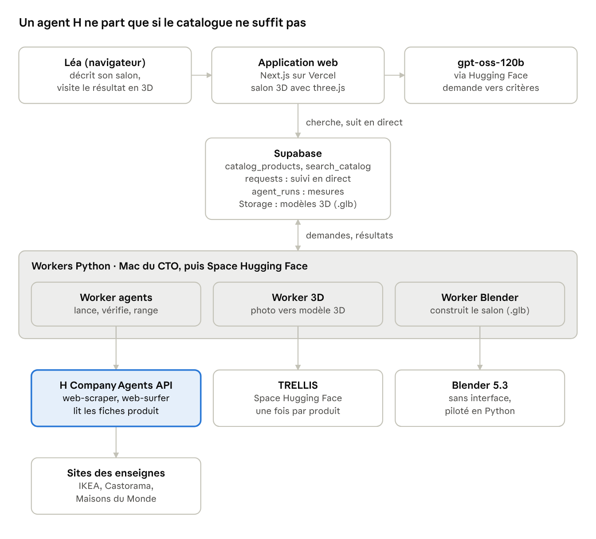

# Nester

**Votre salon en 3D, meublé, décoré et peint avec de vrais produits qui rentrent.**

Hackathon *Build The Future* 2026 (Eugenia × H Company × Hugging Face × Vercel) · Team 12


## Le problème

Meubler un logement prend des heures : chaque enseigne a son format, il faut noter les cotes à la main,
et le canapé finit par ne pas rentrer.

## Lancer l'application (V1)

Deux programmes, dans deux terminaux :

```bash
npm --prefix web install && npm --prefix web run dev     # l'application, sur http://localhost:3000
```

```bash
python3 worker/worker.py                                  # le worker qui traite les demandes
```

- **`web/`** : application Next.js. Les écrans sont dans `web/public/ecrans/` ; les routes `web/app/api/` déposent les demandes
  dans la table Supabase `requests` et lisent l'avancement. La clé secrète Supabase reste côté serveur.
- **`worker/`** : surveille `requests` et enchaîne gpt-oss-120b → `search_catalog` → agent H si le catalogue ne suffit pas
  (`holo run`, fiche ajoutée au catalogue, mesure dans `agent_runs`) → Blender → fichier `.glb` dans Supabase Storage.
- Un projet se retrouve par son lien : `/ecrans/rendu-3d.html?p=<identifiant>`.

Il faut : le fichier `.env` (voir `.env.example`), Blender dans `prototypes/tools/`, un jeton Hugging Face (`hf auth login`)
et la commande `holo` connectée (`holo login`). Le worker tourne sur une machine qui a Blender ; l'application peut être
déployée sur Vercel (dossier racine `web`, variables `SUPABASE_URL` et `SUPABASE_SERVICE_ROLE_KEY`).

**Les agents H Company dans l'application**

- Collecte du catalogue (633 fiches, en amont).
- Recherche en direct quand rien ne rentre dans la pièce pour une catégorie.
- Vérification du prix et de la disponibilité des 5 produits IKEA les plus chers après chaque salon (désactivable : `NESTER_VERIFY=0`).
- « Remplacer » avec ses mots (« en velours vert ») : catalogue d'abord, sinon un agent cherche sur ikea.com.
- Écran « Agents » : lancements, taux de réussite, durée médiane, cas d'échec (table `agent_runs`).

**Photos d'inspiration** : sur l'écran Envies, un modèle de vision (`google/gemma-4-31B-it`, Hugging Face Inference Providers) lit jusqu'à
3 photos ; les couleurs et styles détectés guident le choix des produits et du mur d'accent.

**Modèles 3D**, par ordre de préférence : le modèle officiel du fabricant déposé dans Supabase Storage (`models/ikea/<numéro d'article>.glb`,
439 fichiers, déjà aux vraies dimensions) ; sinon un modèle généré par TRELLIS depuis la photo (à la demande, 3 par salon) ;
sinon une forme simple dessinée par Blender.

**Photo réaliste** : sur l'écran du salon, la bascule « 3D | Photo » demande à Blender (moteur Cycles) une vue d'intérieur du même salon,
en une quinzaine de secondes. Les meubles sont ceux de la scène 3D : aucune IA d'image ne les réinvente.

Pas encore branché : critères de l'écran Envies (seconde main, animaux…), coussins.

## La solution

L'utilisateur décrit son salon (dimensions, porte, style, budget). Des **agents H Company** lisent les
fiches produit des enseignes comme un humain, une **IA open source de Hugging Face** choisit et classe les
produits, et l'application vérifie que tout rentre avant d'afficher le salon **en 3D avec les vrais produits**.

Pourquoi un agent *computer-use* : les enseignes n'ont pas d'API publique et affichent dimensions et prix
chacune à leur façon.

## Architecture



Détails : [docs/architecture.md](docs/architecture.md)

| Brique | Outil |
|---|---|
| Interface | Next.js sur Vercel + three.js |
| Agents | H Company Agents API (`web-scraper`, `web-surfer`) |
| IA texte | `openai/gpt-oss-120b` via Hugging Face Inference Providers |
| IA 3D | TRELLIS (Space Hugging Face) : photo du produit → modèle 3D |
| Modélisation | Blender 5.3 sans interface, piloté en Python |
| Données | Supabase : catalogue, demandes, mesures, fichiers 3D |

## Contenu du dépôt

```
docs/                     architecture, schéma, review, mises à jour de la présentation
prototypes/
  blender/build_salon.py  JSON du salon -> salon 3D (.glb) + image
  viewer/index.html       visionneuse three.js
  models3d/image_to_3d.py photo produit -> modèle 3D (TRELLIS, Hunyuan3D-2)
  ai/tag_products.py      style et couleur des produits (gpt-oss-120b)
  supabase/               migrations SQL du catalogue + tests
```

## Lancer les prototypes

Prérequis : macOS, Python 3, [Blender 5.3](https://www.blender.org/download/), un jeton Hugging Face
(`hf auth login`). Les clés ne sont jamais commitées : voir `.env.example`.

Construire un salon (le chemin de Blender est à adapter) :

```bash
cd prototypes/blender
/Applications/Blender.app/Contents/MacOS/Blender --background --factory-startup \
  --python build_salon.py -- scene_ektorp_trellis.json out/salon_trellis.glb out/rendu.png
```

Afficher le salon dans le navigateur :

```bash
python3 -m http.server 8765 --directory prototypes
```

Puis ouvrir `http://localhost:8765/viewer/index.html?salon=salon_trellis`.

Générer un modèle 3D depuis une photo :

```bash
cd prototypes && python3 -m venv .venv && .venv/bin/pip install -r requirements.txt
.venv/bin/python models3d/image_to_3d.py chemin/photo.jpg models3d/out trellis
```

Classer des produits (style, couleur, hors sujet) :

```bash
python3 prototypes/ai/tag_products.py prototypes/ai/sample_products.json
```

## État au 17.11.2026

| Hypothèse | Verdict |
|---|---|
| Blender construit le salon depuis un JSON | Validée (< 1 s) |
| three.js l'affiche | Validée (< 0,1 s) |
| Photo → vrai produit en 3D (TRELLIS) | Validée (32 s par produit) |
| gpt-oss-120b classe les produits | Validée (9/9) |
| Catalogue Supabase comme cache | Validée (18 produits réels) |
| Agents sur Maisons du Monde | Fragile : prix absents, blocages anti-robot |

Prochaines étapes : interface Next.js, table `requests` et Storage dans Supabase, workers branchés de bout en bout.

## Équipe

| Rôle | Nom |
|---|---|
| CEO | Lili Sheppard |
| CTO | Hugo Fissier |
| CPO | Arquam El Mezouari |
| CDO | Victor Bella |
| CAO | Apolline Bouquet |
| CAIO | à attribuer |

Les photos et données produits appartiennent à leurs enseignes ; elles ne servent ici qu'au prototype de
démonstration.
