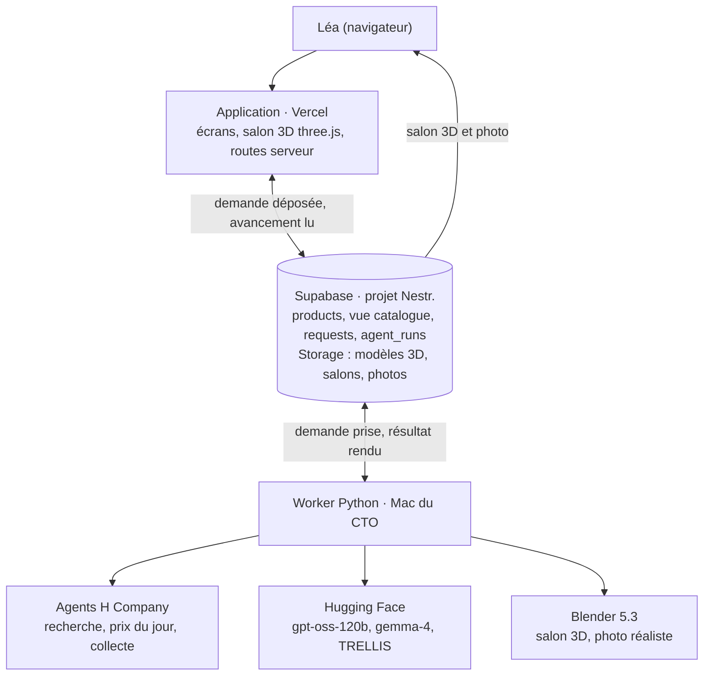

# Architecture technique — Nester V1

*Mise à jour : 19.11.2026 · CTO : Hugo Fissier*

Nester est en ligne sur https://nester-mu.vercel.app : une demande donne un salon complet de 13 produits réels, affiché en 3D,
en 12 secondes en médiane. Le document complet, avec les mesures et les coûts, est dans
[Nester-architecture-V1-et-couts.pdf](Nester-architecture-V1-et-couts.pdf) (version Word à côté).

## Principe

- **L'application ne parle qu'à Supabase** : elle dépose une demande dans `requests` et lit son avancement.
- **Le worker est le seul à appeler les services** (agents H, Hugging Face, Blender). C'est aussi le seul point hors cloud.
- **Le catalogue passe avant les agents** : un agent ne part en direct que si rien ne rentre dans la pièce, ou si Léa décrit
  un produit que le catalogue n'a pas. Après chaque salon, cinq agents vérifient les prix du jour.
- **La clé secrète Supabase reste côté serveur** (routes Vercel et worker) ; la clé publique ne lit que le catalogue.

## Parcours d'une demande (délais médians, 22 salons)

| # | Étape | Brique | Délai |
|---|---|---|---|
| 1 | Saisie : dimensions, porte, style, budget, texte, photos | Application | — |
| 2 | Critères tirés du texte et des photos | gpt-oss-120b, gemma-4 | 2,4 s |
| 3 | Recherche par catégorie dans le budget | `search_catalog` | 3,4 s |
| 4 | Si rien ne rentre : recherche sur ikea.com | Agent H | 42 s, rare |
| 5 | Salon aux vraies dimensions, déposé dans le Storage | Blender | 2,8 s |
| 6 | Prix du jour des 5 produits les plus chers | 5 agents H | 28 s, après affichage |
| 7 | Modèle 3D des meubles qui n'en ont pas (3 au plus) | TRELLIS | 30 s par meuble |
| 8 | À la demande : photo réaliste | Blender Cycles | 18 à 20 s |

## Où est le code

| Dossier | Rôle |
|---|---|
| `web/` | Application Next.js : écrans (`public/ecrans`), routes serveur (`app/api`) |
| `worker/` | `worker.py` (file de demandes), `pipeline.py` (étapes), `agent.py` (agents H) |
| `prototypes/blender/build_salon.py` | Construction du salon et rendu photo |
| `prototypes/supabase/migrations/` | Tables, vue du catalogue, recherche |
| `prototypes/models3d/` | Génération 3D par lot et à la demande |

Mesures des agents, coûts et risques : voir le document complet.
