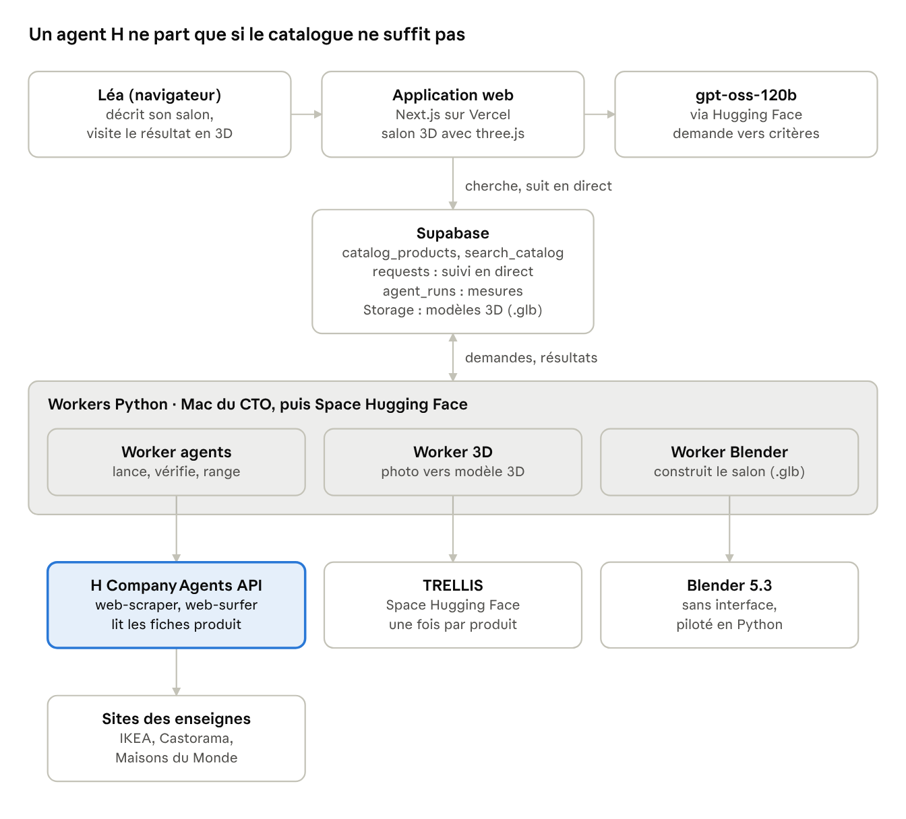
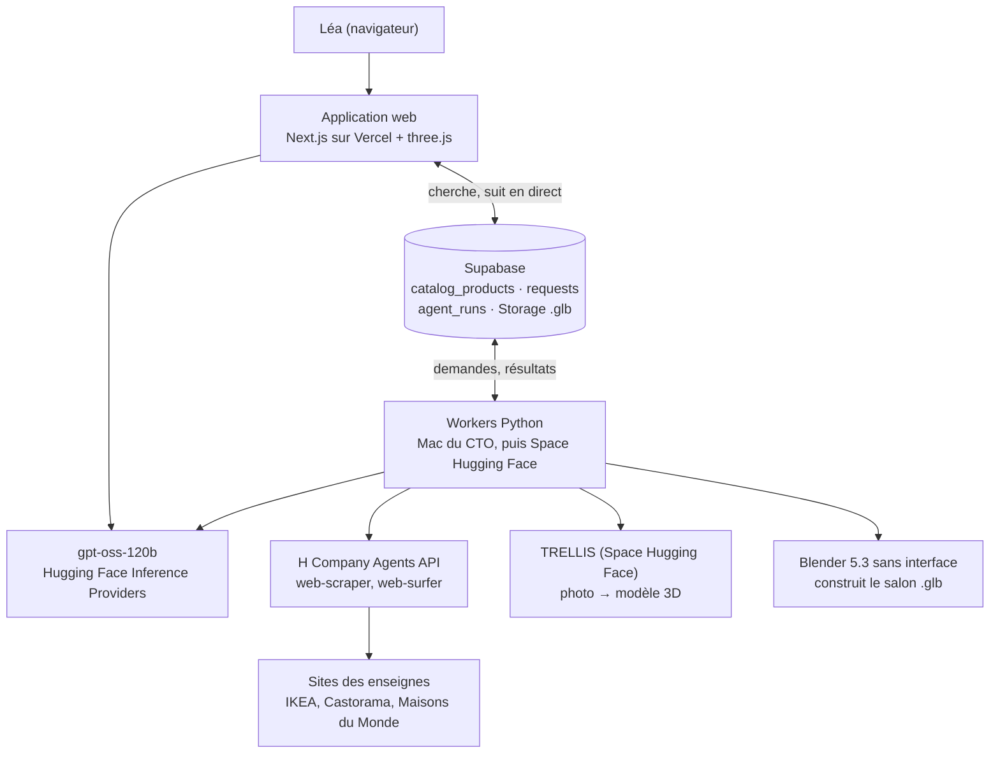

# Architecture technique — Nester

*Mise à jour : 17.11.2026 · CTO : Hugo Fissier*

Nester meuble un salon avec de vrais produits qui rentrent, affichés en 3D.
Toutes les briques ci-dessous ont été testées le 17.11 sur des données réelles, sauf l'interface Next.js.

## Principe

- **Les agents H Company sont le cœur du produit** : ils lisent les fiches des enseignes, qui n'ont pas d'API publique.
- **Le catalogue Supabase passe avant les agents** : on ne lance un agent que si le catalogue ne suffit pas.
- **Tout ce qui est lent tourne dans des workers** : l'application dépose une demande dans Supabase, les workers la traitent, la page se met à jour en direct (Supabase Realtime).
- **Les clés restent côté serveur** : la clé publique Supabase ne peut que lire le catalogue.

## Parcours d'une demande

| # | Étape | Brique | Temps mesuré |
|---|---|---|---|
| 1 | Léa décrit son salon (dimensions, porte, fenêtre, style, budget) | Application | — |
| 2 | La demande devient une liste de courses (catégorie, dimensions max, budget, styles, mots-clés) | gpt-oss-120b | ~3 s |
| 3 | Recherche dans le catalogue : rentre même déplié, colis passe la porte, budget, style | `search_catalog` | instantané |
| 4 | S'il manque des produits : un agent cherche sur l'enseigne | Agents API H | 50 s (3 URL) à 340 s (recherche) |
| 5 | Vérification du JSON, style et couleur, hors sujet écarté, enregistrement | Worker + gpt-oss-120b | 7,8 s pour 9 produits |
| 6 | Modèle 3D du produit depuis sa photo (une fois par produit) | TRELLIS | 32 s |
| 7 | Construction du salon aux vraies dimensions | Blender | < 1 s |
| 8 | Affichage 3D + liste d'achat | three.js | < 0,1 s |

## Stack

| Brique | Outil | Statut au 17.11 |
|---|---|---|
| Interface | Next.js sur Vercel (crédits v0) | À construire |
| Affichage 3D | three.js | Validé ; éclairage à régler |
| Agents | H Company Agents API | Validé sur IKEA et Castorama, fragile sur Maisons du Monde |
| IA texte | `openai/gpt-oss-120b` via Hugging Face, `response_format: json_object`, `max_tokens` 4000 | Validé |
| IA 3D | TRELLIS, Space `trellis-community/TRELLIS` | Validé ; quota partagé |
| Modélisation | Blender 5.3 sans interface + Python | Validé |
| Données | Supabase (Postgres, Storage, Realtime) | Catalogue validé ; `requests` et Storage à créer |
| Code | GitHub | En place |

## Données

Voir [prototypes/supabase/README.md](../prototypes/supabase/README.md) et les migrations SQL dans
[prototypes/supabase/migrations/](../prototypes/supabase/migrations/).

## Risques et plans B

| Risque | Plan B |
|---|---|
| Maisons du Monde bloque l'agent ou cache les prix (arrivé le 17.11) | Réintégrer IKEA ; catalogue pré-rempli |
| Agent trop lent en démo live | Un seul agent en direct, le reste depuis le catalogue ; affichage au fur et à mesure |
| Panne ou quota du Space TRELLIS | Modèles 3D de démo générés à l'avance |
| Worker arrêté | Salon de démo déjà généré dans Supabase Storage |
| Réponse IA mal formée | Sortie JSON imposée, vérifiée, une relance |
| Données des enseignes | Démo uniquement ; conditions d'utilisation et affiliation à vérifier avant production |

## Mesures

Chaque lancement d'agent est enregistré dans `agent_runs` (11 au 17.11). Les chiffres viennent de peu
d'essais : avant vendredi, relancer chaque étape une vingtaine de fois pour un vrai taux de réussite.
